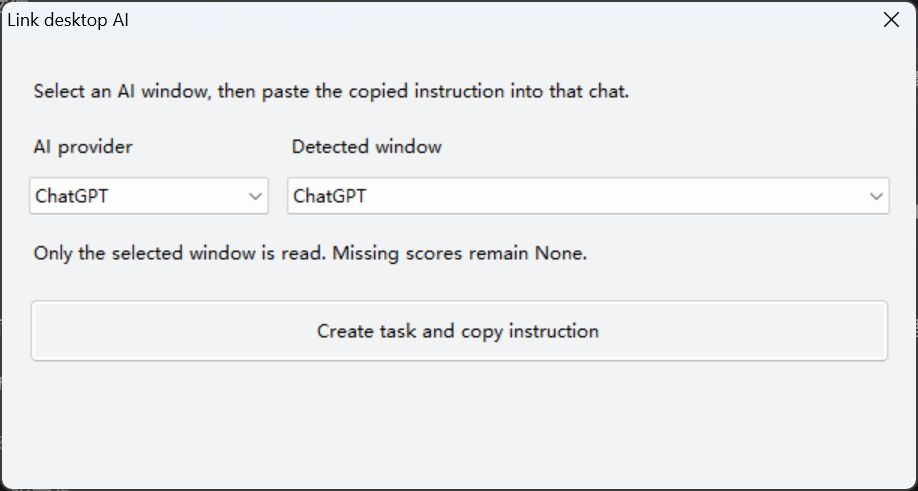

# More Accurate

English · [简体中文](README.zh-CN.md) · Windows 10/11 · 1.2.0


A transparent, topmost indicator for **AI requirement understanding**. Each startup resets the previous selection and shows an unnamed `None` bar. A fresh report or new connection can show the first task; historical tasks stay in the task selector until you select them. During that run you can manually select up to four. Double-click separate bars to combine them into contiguous equal sectors of one water-level ball. Scores are AI self-reports, not answer-correctness probabilities.

## Visual guide

Startup: no invented AI name or task number, no stale score.


The five color bands follow **requirement understanding**, not execution completion. These are controlled examples rendered by the app with fixed sample scores:

| Understanding band | Example |
| --- | --- |
| Below 25% · dusty pink |  |
| 25% to below 50% · apricot |  |
| 50% to below 75% · cream |  |
| 75% to below 90% · lavender |  |
| 90% to 100% · mint |  |

Execution example: the larger percentage is requirement understanding; the separate lower strip follows actual task milestones and disappears when execution stops.


Four selected tasks share a compact ball. Double-click it to restore bars. Each wedge has its own water level and outside progress arc; the displayed ball uses a 150-pixel window canvas before Windows display scaling.


The indicator images above are controlled examples rendered by the application's drawing code with test data. They are not live AI scores. The connector image below is an actual Windows dialog capture; it contains no conversation content.



The connector uses system fonts and automatic text-row heights to prevent clipped labels at display scaling. Select a window to suggest its AI provider; the provider dropdown remains editable. Use the website extension for browser chats, because the desktop connector selects a whole window rather than an individual tab.

While the connector or task selector is open, indicator surfaces are temporarily hidden and restored afterwards. This keeps their topmost timers from covering the dropdowns, list or buttons.

## Install

Extract the ZIP to a permanent folder and run `Install.cmd`, or:

```powershell
powershell -NoProfile -ExecutionPolicy Bypass -File .\setup.ps1
```

Uses Windows .NET Framework and PowerShell 5.1. No Python, Node or API key required for normal use. Setup creates the desktop shortcut and registers Chrome/Edge native messaging. If Codex is installed, setup also installs the Chinese Skill and MCP; fully restart Codex, then invoke `$more-accurate`. For English guidance replace the installed Skill with `codex-skill/SKILL.en.md`. The executable is unsigned. Keep the extracted folder.

## Connect your AI

| Entry | Connection |
| --- | --- |
| Codex | Skill + MCP, stable independent `taskId` per task |
| ChatGPT, DeepSeek, Claude, Gemini websites | Chrome / Edge extension, AI-reported score markers |
| Windows desktop clients, including Codex | Right-click → Link desktop AI → select provider/window → paste the copied instruction into that new chat once |

### Manually install the Chrome / Edge extension

Setup registers the native host; **it does not automatically load the browser extension**. Complete these steps on first use, or when automated installation is unavailable.

1. Install and open the browser you want to use. Open `edge://extensions` in Edge or `chrome://extensions` in Chrome.
2. Enable **Developer mode**.
3. Click **Load unpacked**.
4. Select the **`browser-extension` folder** inside the extracted project. Do not select the ZIP, the project root or an individual file. For example, if the project is in a desktop folder named `more accurate-skill`, select `Desktop\more accurate-skill\browser-extension`.
5. Confirm that **More Accurate** appears in the extension list and is enabled.
6. Open a supported AI website, click More Accurate in the browser's extensions menu, and check **Enable**. **Add instruction** is checked by default and can be turned off.
7. Refresh the AI page, then submit your own question. The indicator displays understanding only after the AI reports a valid score marker; missing scores remain `None`.

Load the extension **separately in Edge and Chrome**. Skip a browser that is not installed. If you move the project folder, rerun `install-browser-bridge.ps1` and reload the extension from its new location. Keep the extension folder after loading it.

If the extension reports no connection, confirm that the indicator is running, run `install-browser-bridge.ps1` from the project folder, refresh the AI page, and click **Retry** in the extension. Successful native-host registration does not mean the extension has been loaded or that the AI's live website has been verified compatible.

The extension appends instructions only when you submit your own message. It never sends a message for you. AI markers remain visible in replies. Only structured markers go to the local native host. Failure stops automatic retries; click Retry after fixing the connection. Disabling linking or closing the tab clears the current score and execution indicator.

**Desktop clients:** Create a connection for each new chat and paste its unique instruction once. The reader checks only the selected window's Windows accessibility tree, with per-task random markers. Inaccessible content, different privilege levels or unsupported clients mean `None`. Retry in the task selector. This cannot read internal reasoning or force clients to expose their replies.

## Interaction

- Startup and missing fresh reports show `None`, never an old score.
- New reports briefly show three bouncing dots, then animate the percentage.
- Startup does not select a historical task. The first fresh report/connection can appear automatically; choose up to four explicitly in the context menu. Two or more selected bars identify the AI and task number.
- Double-click a bar to combine selected tasks into contiguous true pie-chart wedges: halves, thirds or quarters radiating from the center. Each sector retains its own water level, percentage, AI name and task number. Double-click the ball to restore bars.
- Actual execution shows a thicker strip below a bar, or an arc outside that task's sector. The entire **sector arc** represents all steps. Known totals use completed/total milestones; unknown totals flow without invented percentages. Completion, interruption and waiting hide progress immediately. No white or completed background track remains.
- Drag any bar to move the selected bars together, keeping their relative positions inside monitor work areas; water reacts with damped waves. Optional launch-at-login and position memory default off. Right-click → Language switches Chinese/English across bars, ball, menus, tray and newly opened dialogs.

Light gray surfaces, antialiased black contours, subtle downward shadows and transparent surroundings. Indicators have no native window chrome or taskbar button; the connector and selector are standard dialogs. Indicator content and context menus use local handwriting fonts: Comic Sans MS / Segoe Print / Ink Free; Chinese STXingkai / KaiTi. Setup dialogs and the task selector use system fonts for readability. Missing fonts fall back to system fonts; no font files are distributed. Pastel bands: dusty pink below25, apricot25–50, cream50–75, lavender75–90 and mint90–100.

Topmost applies to ordinary desktop windows; Windows controls secure desktops, exclusive full-screen and ordering among other topmost windows. Step ratios are not time estimates.

## Honesty, performance and compatibility

The Skill prioritizes material clarification, admits evidence gaps and prohibits invented facts, sources, model identity and execution results. Fiction/examples need an explicit request. 100% means material requirements are clear, not guaranteed success. Attachment instructions are not user authorization. Skills and pasted prompts cannot technically guarantee model compliance or correctness.

Sync once per new request, resubmit only changes, and report real milestones instead of heartbeats. Connection failure suspends retries until explicit recovery. End-to-end speed improvement has not been measured.

**Verified in isolation:** MCP/native framing and four web providers, task/nonce validation, controlled fixtures for five supported domains, four-task selection, equal1/2/3/4 contiguous sector geometry, independent outer arcs, monitor boundaries, accessibility reading from a controlled Windows fixture, installer and legacy checks.

**Live AI websites and each vendor's actual desktop client have not been individually verified.** Website changes and accessibility support can break adapters. Controlled fixtures are not a compatibility certification. Hidden browser conversations are not continuously observed; visible desktop content depends on the client. Legacy MCP without `taskId` shares `codex-legacy`; restarting Codex is required to load upgraded tools.

## Local data and troubleshooting

`app/data/` holds task markers, short notes, steps, selection, position and language. It is excluded from Git/ZIP. The extension does not store or transmit transcripts, and uses local native messaging. The desktop reader examines accessible text only in memory. This version's main UI no longer starts the old model/network telemetry reader or adds telemetry configuration; legacy source is retained for development checks.

For `Transport closed`, fully restart Codex and check the MCP is enabled. For browser failures, check extension activation/native registration, refresh and Retry. For desktop failures, select the correct window and paste its instruction; inaccessible replies stay unknown. At startup, `visible: 0` with `surfaces: 1` in `hub-status.json` means the unnamed `None` bar is present, not that the app failed to start. Historical tasks remain available in the selector; they are not erased. `hub-status.json` records selection/observer failures, and `display-<taskId>.json` records bar paints.

Exit the indicator before running `uninstall.ps1`, then remove the extension in each browser. Uninstall preserves local display data and removes only matching project registrations.

## Repository

Includes matching executable/source, icons, extension, install/uninstall scripts, bilingual Skill/docs, tests, Windows CI and `SHA256SUMS.txt`. See [CONTRIBUTING.md](CONTRIBUTING.md). Upload this folder including `.github` and `.gitignore`, excluding local data/configuration/backups. No automatic GitHub publication.

No open-source license has been selected; rights are reserved. Source visibility does not grant a license. The app icon follows the user's supplied sketch; the retained legacy OpenAI asset came from its [official favicon](https://developers.openai.com/favicon.png).
