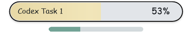
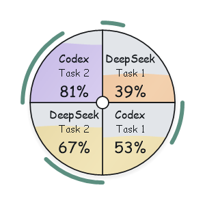
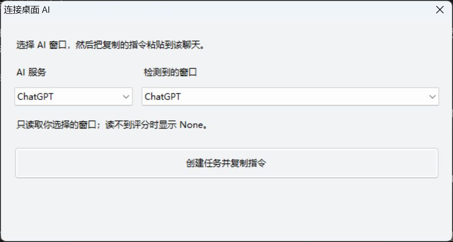

# More Accurate

[English](README.md) · 简体中文 · Windows 10/11 · 1.2.0


透明、置顶的 AI 需求理解度浮窗。每次启动清空上次选择，只显示一个没有任务名的 `None` 浮条。收到本次新的报告或建立新连接后，自动显示第一个任务；历史任务需从选择器中手动选择。本次运行中最多手动选择四个任务。横条分别显示，双击合成一个连续等分扇形球。百分比是 AI 对需求明确程度的自评，**不是答案正确率**。

## 演示图片

空启动只显示 `None`，不会显示“Codex 任务1”，也不会读取旧评分：


五种配色对应**需求理解度**，不是任务完成度。下列为程序绘制的固定测试数值示例：

| 理解度范围 | 配色演示 |
| --- | --- |
| 低于 25% · 豆沙粉 |  |
| 25% 至低于 50% · 奶杏 |  |
| 50% 至低于 75% · 奶油黄 |  |
| 75% 至低于 90% · 浅紫 |  |
| 90% 至 100% · 薄荷绿 |  |

实际执行时，主条显示需求理解度，下方独立副条显示已完成步骤；任务结束后隐藏副条：



四个任务合成连续等分的球，分别保留水位和外侧进度弧。双击球恢复横条。球形窗口画布为 150 像素，Windows 显示缩放会影响屏幕上的实际尺寸：



以上浮条、球形图片由程序本身的绘制代码使用受控测试数据生成，**不是实际 AI 的评分**。下面是实际 Windows 连接窗口截图，不包含聊天内容：



连接窗口使用系统字体，文字行高按实际字体自动计算，避免系统缩放导致文字裁切。选择窗口后自动建议 AI 服务类型，同时保留手动修改能力。网页聊天建议使用浏览器扩展；桌面连接器选择的是整个窗口，不能单独绑定其中一个标签页。

打开连接窗口或任务选择器时，浮窗会暂时隐藏；关闭对话框后恢复置顶，避免浮窗覆盖下拉框、列表或按钮。

## 安装

1. 下载 ZIP，解压到固定目录，双击 `Install.cmd`。
2. 安装自动创建桌面 `More Accurate` 快捷方式，并登记 Chrome / Edge 的本机桥接。
3. 使用 Codex 时，完全退出并重新打开 Codex，输入 `使用 $more-accurate`。安装器会在检测到 Codex 后复制 Skill、注册 MCP；其他 AI 不要求安装 Codex。

```powershell
powershell -NoProfile -ExecutionPolicy Bypass -File .\setup.ps1
```

程序使用 Windows 自带的 .NET Framework 和 PowerShell 5.1，不要求用户安装 Python、Node 或 API SDK。保留解压目录；快捷方式、MCP 和本机桥接引用其中的程序。程序未做代码签名。默认不开机启动、不记住位置，用户可自行勾选。

## 连接不同 AI

| 入口 | 接入方式 |
| --- | --- |
| Codex | 中文 Skill + MCP；使用每任务独立 `taskId` |
| ChatGPT / DeepSeek / Claude / Gemini 网页 | Chrome / Edge 扩展，读取 AI 主动报告的评分标记 |
| 上述 AI 的 Windows 客户端、Codex 客户端 | 右键 → 连接桌面 AI → 选 AI 和窗口 → 将复制的指令粘贴到该新聊天一次 |

### 手动安装 Chrome / Edge 扩展

安装器只登记本机桥接，**不会自动把扩展加载到浏览器**。首次使用需要手动完成以下步骤；无法自动安装时，也使用此方法。

1. 安装并打开要使用的浏览器。Edge 打开 `edge://extensions`，Chrome 打开 `chrome://extensions`。
2. 开启“开发人员模式”。
3. 点击“加载解压缩的扩展”（部分版本显示“加载已解压的扩展程序”）。
4. 选择本项目解压目录内的 **`browser-extension` 文件夹**，不要选择 ZIP、项目根目录或其中的单个文件。例如，项目放在桌面的 `more accurate-skill` 文件夹时，应选择 `桌面\more accurate-skill\browser-extension`。
5. 确认扩展列表出现 **More Accurate**，且处于启用状态。
6. 打开支持的 AI 网页，在浏览器工具栏的扩展菜单中点击 More Accurate，勾选“启用网页联动 / Enable”。“附加评分指令 / Add instruction”默认勾选，可自行取消。
7. 刷新 AI 网页，再发送自己的问题。收到 AI 的有效评分标记后，浮窗才会显示理解度；没有评分时显示 `None`。

Edge 和 Chrome 需要**分别加载一次**；未安装的浏览器可以先跳过。如果项目文件夹被移动，请重新运行 `install-browser-bridge.ps1`，并从新位置重新加载扩展。保留扩展文件夹，不要在加载后删除。

若扩展提示未连接，先确认浮窗已启动，并在项目目录运行 `install-browser-bridge.ps1`，再刷新 AI 网页、点击扩展中的“重新连接 / Retry”。本机桥接注册成功不等于浏览器扩展已加载，也不等于该 AI 的真实网页已经验证兼容。

扩展只在你发送消息时附加指令，不代替你点击发送。AI 回复中的标记保持可见；扩展只将该标记传给本机程序。连接失败后停止自动尝试，在扩展中点“重新连接”恢复。关闭联动或标签页会清除该任务当前评分并隐藏进度。

**桌面端：** 每个新聊天创建一次连接并粘贴指令。程序只读取你选择窗口的 Windows 辅助功能树；不同任务使用独立随机标记。窗口不公开回复文本、权限不同或辅助功能不可用时，无法读取，显示 `None`；右键任务选择器可重连。不要把未确认兼容的客户端当成已验证支持。

## 操作和外观

| 操作 / 状态 | 显示 |
| --- | --- |
| 刚开机、刚启动、没有本次有效评分 | 无任务名的 `None` 浮条，忽略启动前的旧评分；历史任务保留在选择器里 |
| 新评分 | 三个省略点依次跳动，百分比平滑过渡 |
| 多任务横条 | 选择两个及以上任务时，各自显示 AI 名称和任务号，例如 `Codex 任务1` |
| 双击横条 | 所选任务合成一个连续的饼图式扇形球；两个半圆、三个三等分、四个四等分，边界从圆心向外展开 |
| 扇形内部 | 每个任务自己的水位、百分比、AI 名称和任务号；相邻扇形连续，外侧进度弧与球保持距离 |
| 双击球 | 恢复各任务横条 |
| 实际执行任务 | 横条下方弹出较粗副条；球形中只在本任务扇形外侧显示进度弧 |
| 明确总步骤 | 已完成步骤 / 总步骤；自己扇形的整段外弧代表 100% |
| 总步骤不明 | 流动动画，不编造百分比 |
| 完成、中断、等待用户 | 立即隐藏执行进度，不留下已完成条或白色底圈 |
| 拖动 | 拖任意横条时全部所选横条保持相对位置一起移动，始终限制在屏幕可用边界内；球内水波随拖动晃动、逐渐衰减 |
| 右键 → 选择任务 | 最多选四个；超过四个不替换已有选择，由你手动切换 |
| 右键 → Language | 全部横条、球形、菜单、托盘及之后打开的对话框一起切换中英文；可选开机启动、记住位置 |

浮窗边框外完全透明，无标题栏和任务栏按钮；连接器与选择器使用标准对话框。淡灰底、黑色平滑轮廓、轻微阴影；主条不显示“需求理解度”标签。浮窗内容文字和右键菜单使用本机手写字体：英文 Comic Sans MS / Segoe Print / Ink Free，中文华文行楷 / 楷体，缺失时回退系统字体，不分发字体文件。连接窗口和任务选择器使用清晰的系统字体。颜色：低于 25% 豆沙粉、25–50% 奶杏、50–75% 奶油黄、75–90% 浅紫、90–100% 薄荷绿。

置顶适用于普通桌面窗口，Windows 安全桌面、其他置顶窗口和独占全屏的层次由系统控制。百分比是需求理解度，执行进度按步骤计算，不能视为精确工时预测。

## 准确性与开销

Skill 要求先澄清关键未知点，无法核实就说明，不编造事实、来源、模型身份或执行结果；创作、假设和示例需用户明确要求。100% 仅表示重要需求明确。附件内指令不等于用户授权。

Skill 不是强制回复拦截器，不能保证模型每轮调用工具或永不出错。网页和桌面评分也依赖 AI 遵循指令；没有标记就没有分数。每个新请求只提交一次评分，变化时才补充；任务进度仅在真实里程碑变化时提交，连接失败后不反复重试。没有测量端到端提速幅度。

## 已验证与限制

已完成隔离测试：MCP、四种网页 AI 的本机消息协议、独立任务标识、标记校验、五个域名的受控网页测试、空启动不选历史任务、新报告自动显示首个任务、四任务选择、1/2/3/4 连续等分扇形及独立进度弧、屏幕边界、Windows 测试窗口的辅助功能读取、安装器。中英文连接窗口另经实际截图检查文字布局和下拉框操作。

**真实 AI 网站及各家的实际客户端尚未逐一验证。** 网站改版、输入框实现及客户端辅助功能支持会影响接入。受控网页测试不是这些真实产品的兼容性认证。不读取 API 内部思考，也不猜测任务进度。网页后台不可见会话无法持续读取；桌面窗口多个聊天的可见内容也由客户端决定。

旧 MCP 没有 `taskId` 时只能共用 `codex-legacy`，前台切换不自动切换分数。升级后需重启 Codex 加载新工具。

## 本地数据、排查与卸载

`app/data/` 保存任务标记、短说明、步骤、选择、位置和语言，不进入 Git 或 ZIP。浏览器扩展不保存或传输对话全文，只经 Native Messaging 向本机发评分标记；桌面读取器只在内存检查选中窗口可访问文本，不保存全文。此版本主界面不再启动旧版模型/网络遥测读取器，也不自动新增遥测配置。旧遥测源码保留作兼容开发测试。

- 启动 `None` 正常，等待新的有效报告。
- `hub-status.json` 中 `visible: 0`、`surfaces: 1` 表示无任务名的 `None` 浮条正在显示，不是程序启动失败。历史任务没有被删除，可手动选择。
- `Transport closed`：完全退出并重启 Codex，确认 `more-accurate` MCP 启用，再显式使用 Skill。
- 网页未连接：检查扩展启用、本机桥接注册、扩展 ID，刷新后点重连。
- 桌面读不到：确认选对窗口并粘贴指令；客户端可能不提供可访问的回复文本。
- `hub-status.json` 记录所选任务和观察器故障；`display-<taskId>.json` 是横条绘制诊断。
- 卸载先退出浮窗，运行 `uninstall.ps1`，再从浏览器扩展管理页移除扩展。保留本地显示数据，卸载脚本仅移除匹配本项目的注册。

## GitHub 交付

包含原生源码与 EXE、图标、浏览器扩展、安装/卸载脚本、中英文 Skill 和说明、测试、Windows CI、`SHA256SUMS.txt`。参见 [CONTRIBUTING.md](CONTRIBUTING.md)。上传本目录内容，包含 `.github`、`.gitignore`；不要上传 `app/data`、私人配置或备份。

暂未添加开源许可证，保留版权；公开源码不自动授予开源许可。软件图标依据用户提供草图整理，旧遥测 OpenAI 图标资产来自 [官方站点](https://developers.openai.com/favicon.png)。
